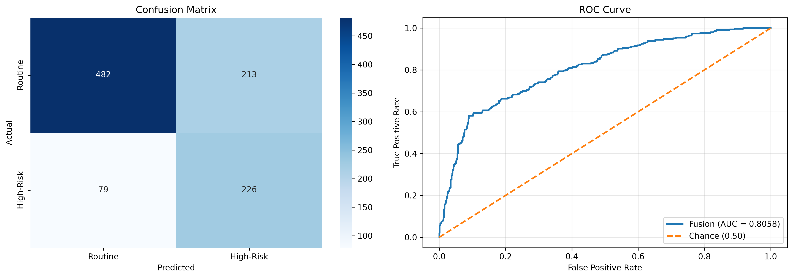
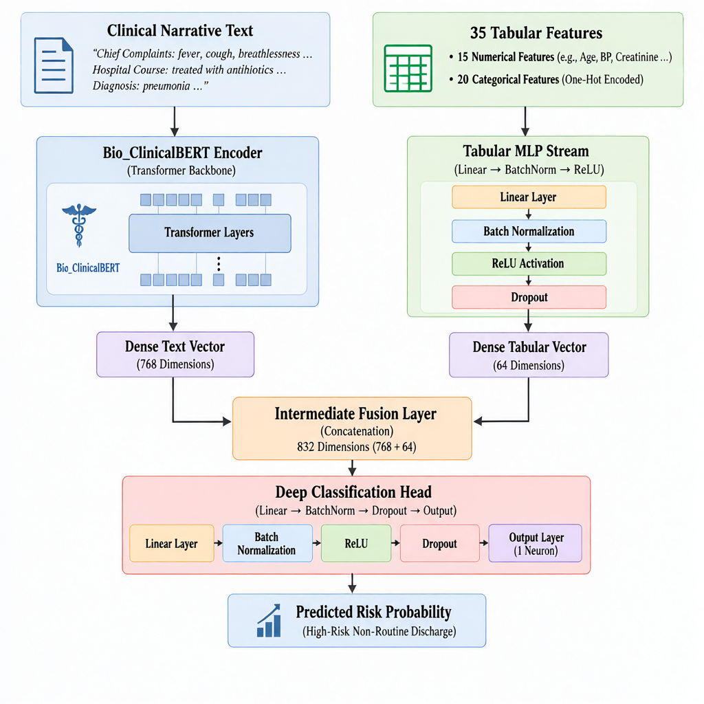
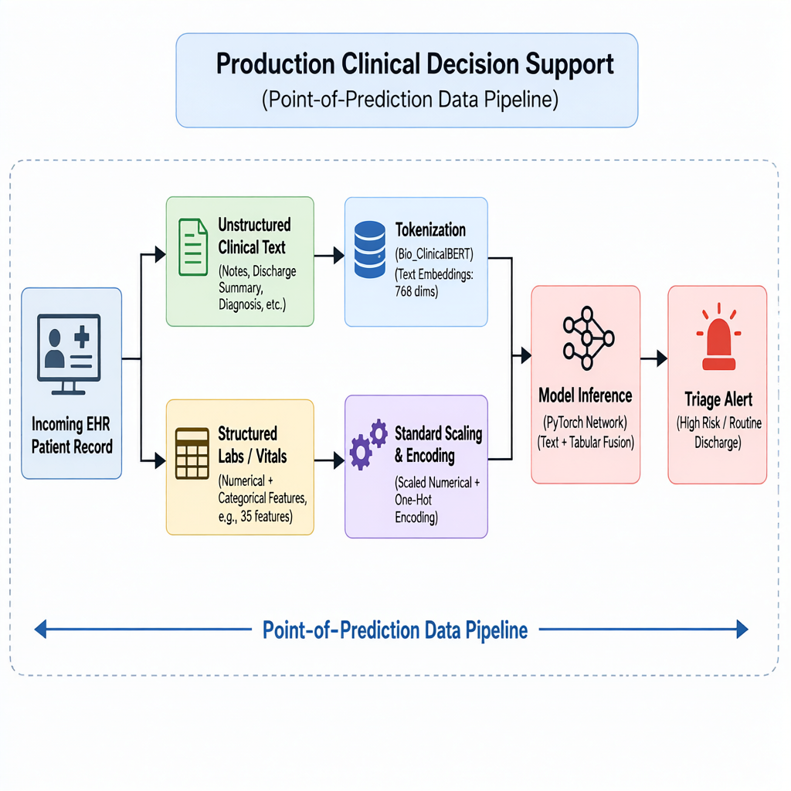

# Multimodal Clinical Discharge Risk Prediction

Predicting **non-routine hospital discharge** — LAMA, discharge on request, or transfer to a higher centre — from free-text clinical notes combined with structured vitals and labs.

[](https://www.python.org/)
[](https://pytorch.org/)
[](https://huggingface.co/docs/transformers)
[](https://scikit-learn.org/)
[](#results)

> **Research and portfolio project.** Built on a de-identified hospital discharge dataset. Not a medical device, not clinically validated.

---

## Contents

- [Overview](#overview)
- [Results](#results)
- [Architecture](#architecture)
- [Dataset](#dataset)
- [Repository layout](#repository-layout)
- [Getting started](#getting-started)
- [Preprocessing and training](#preprocessing-and-training)
- [Engineering notes](#engineering-notes)
- [Limitations](#limitations)

---

## Overview

A two-tower neural network fuses a **Bio_ClinicalBERT** encoding of the clinical narrative with a **tabular MLP** over 35 structured features, and returns the probability that a patient will leave against medical advice, be discharged on request, or be transferred to a higher centre.

| | |
|---|---|
| **Target** | `High_Risk_Discharge` ∈ {0, 1} — derived from `Discharge_Type` |
| **Modalities** | Clinical text (complaints + hospital course + diagnosis) and structured vitals/labs |
| **Model** | Bio_ClinicalBERT `[CLS]` (768-d) ⊕ tabular MLP (64-d) → 832 → 128 → 32 → 1 |
| **Parameters** | 108.4 M |
| **Data** | 5,000 de-identified inpatient records, 30.5% positive |

The target is discharge **disposition**, not mortality or readmission. Those are different outcomes and are deliberately out of scope.

## Results

Checkpoint selected by validation ROC-AUC; the decision threshold maximises F1 **on validation only**, never on test.

| Split | n | ROC-AUC | F1 | Precision | Recall | Accuracy |
|---|---:|---:|---:|---:|---:|---:|
| Validation (threshold selection) | 600 | 0.8301 | 0.6636 | — | — | — |
| Test (held out) | 1,000 | **0.8058** | **0.6075** | 0.5148 | **0.7410** | 0.7080 |

Operating point: **τ = 0.379**. Confusion matrix on the test split —

|  | Predicted routine | Predicted high-risk |
|---|---:|---:|
| **Actually routine** | 482 | 213 |
| **Actually high-risk** | 79 | 226 |

The threshold trades precision for recall: 74% of high-risk discharges are caught, at the cost of 213 false alerts. At the default 0.5 the model is more conservative — validation accuracy is ~79%, but recall drops, so more high-risk discharges are missed. For a triage alert, recall is the metric that matters; raise τ if alert fatigue is the bigger concern.



## Architecture



Text is tokenised to 128 tokens and encoded by Bio_ClinicalBERT; the 768-d `[CLS]` vector is concatenated with a 64-d tabular embedding (35 → 128 → 64). The 832-d fused vector passes through a 128 → 32 → 1 classification head with batch normalisation and dropout (0.3).



## Dataset

5,000 de-identified inpatient records (35 columns, no missing values). Direct identifiers are removed: names are pseudonymised (`PAT_ANON_*`), admission and discharge days are stored as relative day offsets, and age and distance are binned into ranges.

| Group | Fields |
|---|---|
| Narrative | `Chief_Complaints`, `Hospital_Course_Treatment`, `Primary_Diagnosis` |
| Numerical (15) | age, systolic/diastolic BP, heart rate, SpO₂, temperature, respiratory rate, GCS, out-of-pocket cost, prior admissions, active prescriptions, Charlson index, admission creatinine, admission haemoglobin, distance from hospital |
| Categorical (7) | sex, admission type, triage priority, referral source, admission shift, insurance type, caregiver availability |
| Target source | `Discharge_Type` — `Discharged` → 0; `LAMA`, `Discharged on Request`, `Shifted to Higher Center` → 1 |

Class balance is 3,475 routine / 1,525 high-risk (30.5%), handled with a positive-class weight of 2.28 during training.

Neither the CSV nor the model weights are committed (~3.4 MB and ~414 MB respectively). The dataset is not redistributed; access is governed by the source data agreement. Placement is shown in [Getting started](#getting-started).

## Repository layout

```
.
├── data/                                  # dataset (not committed)
├── docs/                                  # architecture and pipeline diagrams
├── models/
│   ├── best_multimodal_model.pt           # weights (not committed)
│   └── preprocessor.json                  # portable preprocessing spec
├── notebooks/
│   └── Multi_Modal_Healthcare_AI.ipynb    # notebook driver over src/
├── src/
│   ├── dataset.py                         # parsing, preprocessing, DataLoaders
│   ├── model.py                           # multimodal fusion network
│   └── train.py                           # two-stage training, checkpoint, evaluation
├── test_metrics.json                      # committed evaluation output
├── multimodal_evaluation_plots.png
├── requirements.txt
└── .gitignore
```

`src/` is the single source of truth. The notebook imports it rather than re-implementing the pipeline.

## Getting started

```bash
git clone https://github.com/RajendharAre/multimodal-clinical-discharge-risk-prediction.git
cd multimodal-clinical-discharge-risk-prediction

python -m venv .venv
source .venv/bin/activate          # Windows: .venv\Scripts\activate
pip install -r requirements.txt
```

Then supply the two ignored artefacts:

```
data/hospital_anynimised.csv
models/best_multimodal_model.pt
```

The weights are shared through the project's Google Drive folder. The dataset is not redistributed and is available only under its source agreement. Everything else — code, diagrams, preprocessing spec, metrics — is in the repository.

**Train** (GPU strongly recommended; ~10–15 min on a T4):

```bash
python -m src.train --device cuda
```

```
Device: cuda
Train samples: 4000 | Test samples: 1000
Tabular feature dimension: 35
Class balance (train): [2780 1220]
```

Training writes `models/best_multimodal_model.pt`, `models/preprocessor.json`, `test_metrics.json`, and `multimodal_evaluation_plots.png`.

**Notebook** — walks the same pipeline step by step and reproduces the metrics from the shipped checkpoint:

```bash
jupyter notebook notebooks/Multi_Modal_Healthcare_AI.ipynb
```

**Verify an artefact pair** (both must be present and from the same run):

```python
import torch

ckpt = torch.load("models/best_multimodal_model.pt", map_location="cpu", weights_only=False)
print(ckpt["feature_dim"], round(ckpt["decision_threshold"], 4))
# 35 0.3785
```

## Preprocessing and training

**Preprocessing** is fitted on the training split only and persisted as `models/preprocessor.json` — medians, means, scales and category lists. It is plain JSON rather than a scikit-learn pickle so the artefact stays valid across library versions; inference never unpickles fitted estimators.

Two source columns arrive as text ranges and are parsed before imputation:

| Raw | Parsed |
|---|---|
| `<18`, `75+`, `30-44` | 10.0, 80.0, 37.0 |
| `0-5 km`, `5-15 km`, `50+ km` | 2.5, 10.0, 65.0 |

**Splits** — 80/20 stratified train/test (seed 42), then 15% of train held out for validation (600 rows). The test split is touched once, at the end.

**Training** is two-stage:

| Stage | Epochs | Text encoder | LR |
|---|---:|---|---|
| 1 — warmup | 3 | frozen | 1e-3 (heads) |
| 2 — fine-tune | 5 | trainable | 1e-5 (BERT), 2e-4 (heads) |

AdamW with weight decay 0.01, linear warmup over 10% of stage-2 steps, gradient clipping at 1.0, batch size 16, BCE-with-logits loss weighted 2.28:1 toward the positive class. The best checkpoint by validation ROC-AUC is restored before evaluation, and the F1-optimal threshold is computed on the validation split.

## Engineering notes

Three defects were found and fixed while hardening this pipeline:

1. **Silent feature loss.** `Distance_From_Hospital_km` is text (`"5-15 km"`), so `pd.to_numeric` nulled it and scikit-learn dropped the all-missing column — the model trained on 34 of its advertised 35 features. Both range columns are now parsed explicitly, and a width check fails loudly if a column ever disappears again.
2. **Age collapse.** `<18` and `75+` failed hyphen parsing and were median-imputed, mapping every paediatric and 75+ patient onto the same mid-life age — 17.5% of the cohort. Open brackets now map to representative values.
3. **Environment-locked preprocessing.** The original artefact was a pickle that failed to load across scikit-learn 1.6 → 1.9. Replaced with a version-independent JSON spec whose transform is implemented in NumPy.

## Limitations

- **Single-source data.** Results come from one de-identified hospital dataset; there is no external or multi-centre validation, and this is not a medical device.
- **Single seed.** Reported metrics come from one 80/20 split; no confidence intervals or repeated runs.
- **Truncation.** Narratives are cut at 128 tokens; long hospital courses lose detail.
- **No calibration.** Probabilities are not reliability-calibrated, so the threshold is a study-specific operating point rather than a transferable clinical cut-off.
- **Disposition, not risk.** The label captures how a stay ended, not physiological deterioration, readmission, or mortality.

---

**Author** — [Rajendhar Are](https://github.com/RajendharAre) · Built with PyTorch and Hugging Face Transformers.
